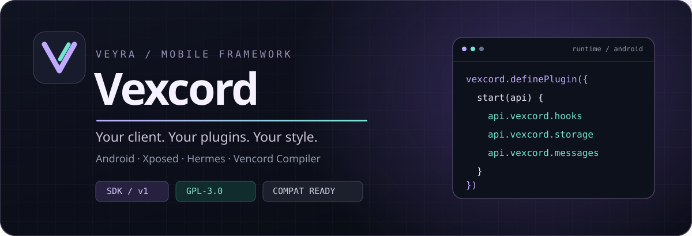
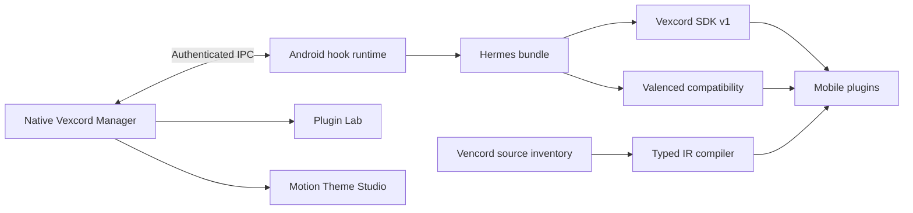

<p align="center">
  
</p>

<p align="center">
  <a href="https://github.com/ctrl-mietze/Vexcord/releases"></a>
  <a href="https://github.com/ctrl-mietze/Vexcord/actions/workflows/android.yml"></a>
  <a href="LICENSE"></a>
  
  
</p>

<p align="center">
  <b>Independent Android Discord extension framework.</b><br>
  A native manager, Hermes plugin runtime, Vencord translation engine and motion theme studio.<br><br>
  <a href="https://github.com/ctrl-mietze/Vexcord/releases"><b>Download</b></a> ·
  <a href="docs/INSTALL.md">Installation</a> ·
  <a href="docs/SDK.md">Developer SDK</a> ·
  <a href="docs/VENCORD_TRANSLATION_MATRIX.md">Plugin matrix</a> ·
  <a href="docs/PLUGIN_SOURCES.md">Sources</a>
</p>

---

## Built for Android

Vexcord extends the existing Discord Android client through an Xposed-compatible framework. No replacement Discord APK is required. The native manager controls the same runtime and plugin state as the in-client settings.

| Area | What is included |
| --- | --- |
| **Plugin Manager** | Compact installed/discover/source/legacy tabs, live connection, dependency-aware installation, grouped source variants |
| **Vencord Compiler** | Full pinned inventory of 167 plugins; 57 mapped entries, 56 distinct mobile targets |
| **Vexcord SDK v1** | Scoped hooks, Metro discovery, Flux observation, local storage, outgoing/edit text adapters, automatic cleanup |
| **Theme Studio** | 13 motion themes with dual gradients and classic moving light circles, palettes, imported themes, fonts, icons and emojis |
| **Plugin Lab** | Isolated Android-process static analysis and bounded simulated JavaScript lifecycle |
| **Runtime** | Kotlin/Xposed bootstrap, React Native/Hermes integration, local diagnostics and recovery |

> The compiler supports known mobile semantics, not arbitrary desktop JavaScript or universal Webpack-to-Metro conversion. Prepared ports and verified repository packages are distinguished from on-device feature tests.

## Vencord on mobile

| Translation status | Entries |
| --- | ---: |
| Source-pattern-generated mobile adapters | 21 |
| Existing integrated ports | 5 |
| Verified Android equivalent mappings | 31 |
| Not yet mapped | 110 |
| **Total investigated** | **167** |

The complete [translation matrix](docs/VENCORD_TRANSLATION_MATRIX.md) includes the source revision, hooks and concrete blockers. The compiler retains original upstream attribution. Five previously activated compiler ports had all expected hook bindings confirmed on a Galaxy S25 Ultra in the 1.0.26 runtime; new ports are not automatically activated or represented as fully tested.

## Installation

1. Get the signed Vexcord APK from [Releases](https://github.com/ctrl-mietze/Vexcord/releases).
2. Install it, enable the module in your existing Xposed/LSPosed manager and select the Discord app scope.
3. Fully restart Discord and open Vexcord.
4. Under **Module**, enable Vencord integration to expose prepared mobile ports in the ordinary **Plugins** list.

**Updating from ValancedX:** retain the existing package and signing certificate. Do not uninstall the previous app first. Vexcord keeps `ctrl.mietze.valacedxposed`, the existing compatibility IDs, source configuration and plugin storage paths. Read the [migration guide](docs/INSTALL.md).

## Developer experience

```ts
export default vexcord.definePlugin({
    start({ vexcord }) {
        vexcord.messages.transformOutgoing(text =>
            text.replaceAll("[demo]", "Vexcord")
        )
    },
})
```

The new API is additive: existing `plugin(...)`, `valenced` and the Valenced module interfaces continue to work. New plugins can use the typed [SDK](sdk/) with their own scoped lifecycle and storage.



## Build from source

Requirements: Java 25, Android SDK 36 and the Deno version pinned in `bundle/.dvmrc`.

```bash
git clone https://github.com/ctrl-mietze/Vexcord.git
cd Vexcord
./gradlew :android:assembleDebug :android:testDebugUnitTest :bundle:testBundle
```

The debug APK uses a different package suffix. Signed updates require the original maintainer signing key; an arbitrary new key cannot update existing installations.

[Architecture](docs/ARCHITECTURE.md) · [Startup and hooks](docs/HOOK_STARTUP.md) · [Compatibility](docs/COMPATIBILITY.md) · [SDK](docs/SDK.md) · [Contributing](CONTRIBUTING.md) · [Changelog](CHANGELOG.md)

## Project lineage & license

Vexcord is independently maintained by ctrl-mietze / Veyra. It continues the ValacedXposed project and includes the open-source [Valenced](https://github.com/Valenced/valenced) core. The Vencord compiler analyzes [Vencord](https://github.com/Vendicated/Vencord) source; mobile equivalents retain their original authors, repositories and manifests.

The repository is independent on GitHub, not a registered fork. Upstream history and license notices remain intact. It is **not** a clean-room rewrite of the underlying Valenced core.

[NOTICE](NOTICE.md) · [GNU GPL v3](LICENSE) · [Vencord source credits](docs/VENCORD_TRANSLATION_MATRIX.md)

Not affiliated with Discord, Inc.
